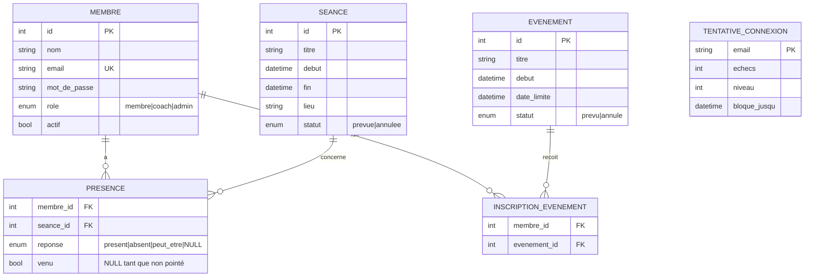

# Waylo Volley Gestion

Application web de gestion d'un club de volley : calendrier, séances (ponctuelles ou récurrentes), événements,
présences, membres. **Monolithe PHP 8.3 + MySQL 8.4**, organisé en **vertical slices** : un dossier = une fonctionnalité.

## Lancer en local

```bash
docker compose up -d --build     # 1er démarrage : ~1 min (build + import du schéma et des données de démo)
# puis ouvrir http://localhost:8080
docker compose down              # arrêt (données conservées)
docker compose down -v           # arrêt + suppression de la base (réimport au prochain up)
```

Tout est local : les ports sont liés à `127.0.0.1`, rien n'est exposé sur le réseau.

**Base déjà existante ?** Appliquez dans l'ordre les scripts de `db/migrations/` (limitation des tentatives, rôle coach, événements),
ou repartez de zéro avec `docker compose down -v`.

### Comptes de démonstration (`db/02-seed.sql`, à supprimer en vrai usage)

| Rôle | Email | Mot de passe |
|---|---|---|
| Admin | `admin@waylo.local` | `admin1234` |
| Coach | `coach@waylo.local` | `membre1234` |
| Membres | `alice@waylo.local`, `bastien@waylo.local`, `camille@waylo.local` | `membre1234` |

## Tests (sans Docker ni MySQL)

```bash
php tests/run.php
```

Chaque slice a son test dans son dossier (`Features/<Slice>/<Slice>Test.php`), exécuté sur une base SQLite en mémoire.
`tests/` contient en plus les tests du noyau (session, rôles, menu, cache des routes, CSV, erreurs) et un test d'ensemble.

## Rôles

Hiérarchie : **membre < coach < admin** (un rôle supérieur hérite des droits des rôles inférieurs).

| Rôle | Peut |
|---|---|
| Membre | Voir le calendrier, répondre aux séances, s'inscrire aux événements, voir ses présences, modifier son profil |
| Coach | + voir les participants, pointer les présences, voir les inscrits aux événements, exporter les présences |
| Admin | + gérer séances, événements et membres, réinitialiser un mot de passe, exporter les membres |

## Fonctionnalités (slices)

| Slice | Rôle | Ce qu'elle fait | Règle métier |
|---|---|---|---|
| `Connexion` / `Deconnexion` | tous | Session, mot de passe haché | Limitation des tentatives (voir ci-dessous) ; compte désactivé refusé ; identifiant de session régénéré |
| `ModifierMonProfil` | membre | Nom, mot de passe | Ancien mot de passe exigé, 8 caractères min. |
| `VoirCalendrier` | membre | Grille mensuelle (liste sur mobile) : séances et événements | Couleur selon ma réponse |
| `VoirDetailSeance` | membre | Fiche séance + boutons de réponse | Actions selon le rôle |
| `RepondrePresence` | membre | Présent / peut-être / absent | Modifiable jusqu'à 2 h avant, pas sur séance annulée |
| `VoirMesPresences` | membre | Historique + taux de présence | Taux = venues / séances pointées |
| `CreerSeance` / `ModifierSeance` / `AnnulerSeance` | admin | Gestion des séances | Fin après début ; pas de modif/annulation d'une séance commencée ; annuler = marquer, jamais supprimer |
| `CreerSeanceRecurrente` | admin | Génère une saison (ex. chaque mardi et jeudi) | 120 séances max, pas de doublon, période non passée |
| `VoirListeParticipants` | coach | Qui a répondu quoi, qui n'a pas répondu | Seuls les membres actifs comptent |
| `PointerPresenceReelle` | coach | Le jour J, cocher qui est venu | Séance commencée et non annulée |
| `ListerEvenements` / `VoirDetailEvenement` | membre | Événements à venir/passés, fiche | - |
| `InscrireEvenement` | membre | S'inscrire / se désinscrire | Avant la date limite, pas en double, pas si annulé |
| `CreerEvenement` / `AnnulerEvenement` | admin | Tournoi, match, soirée | Date limite au plus tard au début ; annuler = marquer |
| `ExporterPresences` / `ExporterInscritsEvenement` | coach | Export CSV (séance, mois ou historique ; inscrits) | Séparateur `;`, BOM UTF-8, anti-injection de formules |
| `ExporterMembres` | admin | Export CSV des membres | Jamais de mot de passe |
| `ListerMembres` | admin | Liste paginée (20 par page) + recherche | - |
| `AjouterMembre` | admin | Création avec mot de passe temporaire | Email unique ; rôle membre, coach ou admin |
| `DesactiverMembre` | admin | Désactiver / réactiver | Jamais de suppression ; pas soi-même ; toujours un admin actif |
| `ReinitialiserMotDePasse` | admin | Nouveau mot de passe temporaire | Débloque aussi un compte bloqué |

### Limitation des tentatives de connexion

Par adresse email (même inconnue, pour ne rien révéler) : 5 échecs = un blocage. Avertissement dès le 3e échec
(« il vous reste 2 tentatives avant blocage »), puis **palier 1 : 1 minute**, **palier 2 : 5 minutes**,
**palier 3 : « Trop de tentatives, contactez un admin. »** Seule une réinitialisation de mot de passe par un admin débloque.
Une connexion réussie remet tout à zéro.

## Architecture : vertical slices

```
public/index.php          front controller (aucune logique métier ; toute erreur => page lisible)
Shared/                   noyau minimal : Database, Session, Context, Router (+ cache), Menu, Layout, Html, Response,
                          Roles, Regles, Csv, SeanceDonnees, SeanceFormulaire, Erreurs, PageErreur
Features/
  <NomDeLaSlice>/
    <Nom>Handler.php      règles métier + SQL (testable, reçoit le PDO et l'heure)
    <Nom>View.php         HTML de la slice
    Route.php             URL, rôle requis, entrée de menu (facultative) et contrôleur
    <Nom>Test.php         tests de la slice
db/                       schéma, données de démo, migrations
docker/, docker-compose.yml
tests/                    lanceur, tests du noyau, test d'ensemble
```

Principes :
- **Une slice = une fonctionnalité de bout en bout** (entrée, règle métier, SQL, affichage, test).
- **Ajouter une fonctionnalité = ajouter un dossier.** Le `Router` découvre les `Route.php` ; le `Menu` se construit tout seul
  à partir des `'menu' => [...]` déclarés par les slices et filtré par rôle (un seul endroit : `Shared/Menu.php`).
- **Cache des routes** : l'index « chemin => Route.php » est mis en cache (`var/cache/`), une requête ne charge que la slice demandée,
  et le cache se reconstruit seul quand un `Route.php` change.
- **Une slice ne dépend pas d'une autre slice**, seulement de `Shared/`. Le code partagé est volontairement petit et ne contient que
  des règles utilisées par plusieurs slices (`Regles`, `SeanceDonnees`/`SeanceFormulaire` pour les séances).
- Le temps (`$now`) et la base (`PDO`) sont injectés : les slices se testent sans serveur.
- Compromis assumé : la factorisation du formulaire de séance (`Shared/SeanceFormulaire`) relie `CreerSeance` et `ModifierSeance`
  au noyau partagé ; en échange on supprime la duplication.

### Erreurs de base de données

Base arrêtée, identifiants refusés, base absente, schéma pas à jour : une page claire avec un conseil (HTTP 503/500),
le détail technique va dans le journal du serveur, jamais à l'écran (mot de passe masqué). `APP_DEBUG=1` affiche le détail masqué en local.

### Données



## Workflow Git

Une branche par fonctionnalité (`feat/...`, `fix/...`, `refactor/...`, `perf/...`, `docs/...`), des commits atomiques,
fusion dans `main` avec `--no-ff` pour garder l'historique des slices lisible (`git log --graph --oneline`).

## Pistes d'évolution

Capacité maximale et liste d'attente, rappels par email, statistiques de présence, plusieurs équipes.
