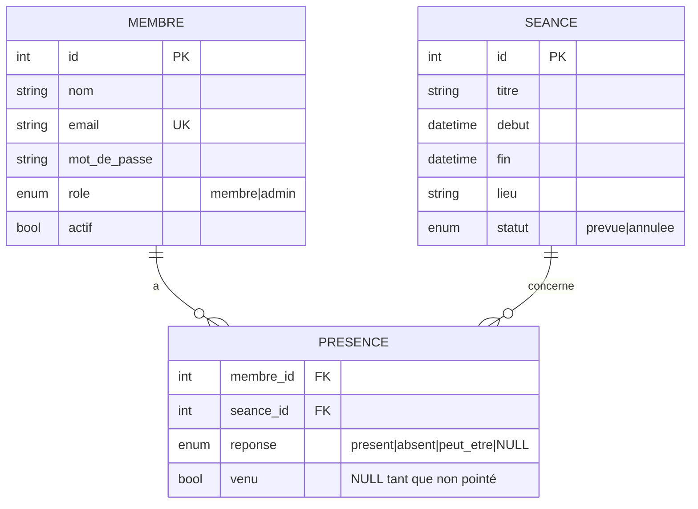

# Waylo Volley Gestion

Application web de gestion d'un club de volley : calendrier, séances, présences, membres.
**Monolithe PHP 8.3 + MySQL 8.4**, organisé en **vertical slices** : un dossier = une fonctionnalité.

## Lancer en local

```bash
docker compose up -d --build     # 1er démarrage : ~1 min (build + import du schéma et des données de démo)
# puis ouvrir http://localhost:8080
docker compose down              # arrêt (données conservées)
docker compose down -v           # arrêt + suppression de la base (réimport au prochain up)
```

Tout est local : les ports sont liés à `127.0.0.1`, rien n'est exposé sur le réseau.

### Comptes de démonstration (`db/02-seed.sql`, à supprimer en vrai usage)

| Rôle | Email | Mot de passe |
|---|---|---|
| Admin | `admin@waylo.local` | `admin1234` |
| Membre | `alice@waylo.local`, `bastien@waylo.local`, `camille@waylo.local` | `membre1234` |

## Tests (sans Docker ni MySQL)

```bash
php tests/run.php
```

Chaque slice a son test dans son dossier (`Features/<Slice>/<Slice>Test.php`), exécuté sur une base SQLite en mémoire.

## Fonctionnalités (MVP)

| Slice | Rôle | Ce qu'elle fait | Règle métier |
|---|---|---|---|
| `Connexion` / `Deconnexion` | tous | Session, mot de passe haché | Compte désactivé = refusé |
| `ModifierMonProfil` | membre | Nom, mot de passe | Ancien mot de passe exigé, 8 caractères min. |
| `VoirCalendrier` | membre | Séances du mois, ma réponse, nb de présents | - |
| `VoirDetailSeance` | membre | Fiche séance + boutons de réponse | - |
| `RepondrePresence` | membre | Présent / peut-être / absent | Modifiable jusqu'à 2 h avant, pas sur séance annulée |
| `VoirMesPresences` | membre | Historique + taux de présence | Taux = venues / séances pointées |
| `CreerSeance` / `ModifierSeance` / `AnnulerSeance` | admin | Gestion des séances | Fin après début ; pas de modif/annulation d'une séance commencée ; annuler = marquer, jamais supprimer |
| `VoirListeParticipants` | admin | Qui a répondu quoi, qui n'a pas répondu | Seuls les membres actifs comptent |
| `PointerPresenceReelle` | admin | Le jour J, cocher qui est venu | Séance commencée et non annulée |
| `ListerMembres` / `AjouterMembre` / `DesactiverMembre` | admin | Gestion des comptes | Jamais de suppression ; pas d'auto-désactivation ; toujours un admin actif |

## Architecture : vertical slices

```
public/index.php          front controller (aucune logique métier)
Shared/                   noyau minimal : Database, Session, Context, Router, Layout, Html, Response, Regles
Features/
  <NomDeLaSlice>/
    <Nom>Handler.php      règles métier + SQL (testable, reçoit le PDO et l'heure)
    <Nom>View.php         HTML de la slice
    Route.php             déclare l'URL, le rôle requis et le contrôleur
    <Nom>Test.php         tests de la slice
db/                       schéma et données de démo
docker/, docker-compose.yml
tests/                    lanceur + test d'ensemble
```

Principes :
- **Une slice = une fonctionnalité de bout en bout** (entrée, règle métier, SQL, affichage, test).
- **Ajouter une fonctionnalité = ajouter un dossier.** Le `Router` découvre automatiquement les `Route.php`, il n'y a aucun fichier central à modifier.
- **Une slice ne dépend jamais d'une autre slice**, seulement de `Shared/`. Le seul code partagé par plusieurs slices est la règle du délai de réponse (`Shared/Regles.php`).
- Le temps (`$now`) et la base (`PDO`) sont injectés : les slices se testent sans serveur.
- Compromis assumé : un peu de duplication (par exemple les formulaires de création et de modification d'une séance) en échange de slices indépendantes.

### Données



## Workflow Git

Une branche par fonctionnalité (`feat/...`, `fix/...`, `docs/...`), des commits atomiques, fusion dans `main` avec `--no-ff` pour garder l'historique des slices lisible (`git log --graph --oneline`).

## Pistes d'évolution (hors MVP)

Capacité maximale et liste d'attente, séances récurrentes, événements avec inscriptions, rôle coach, plusieurs équipes.
